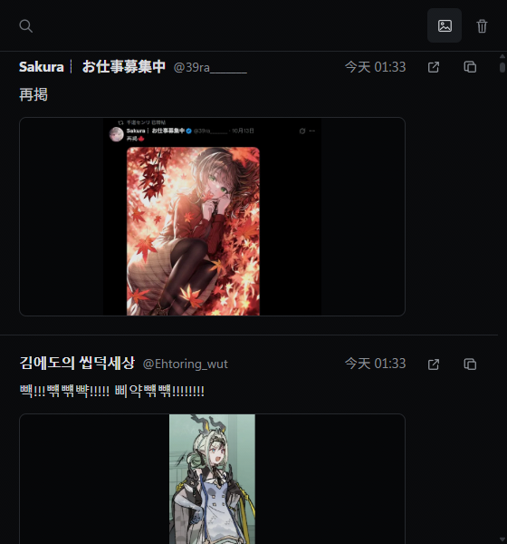
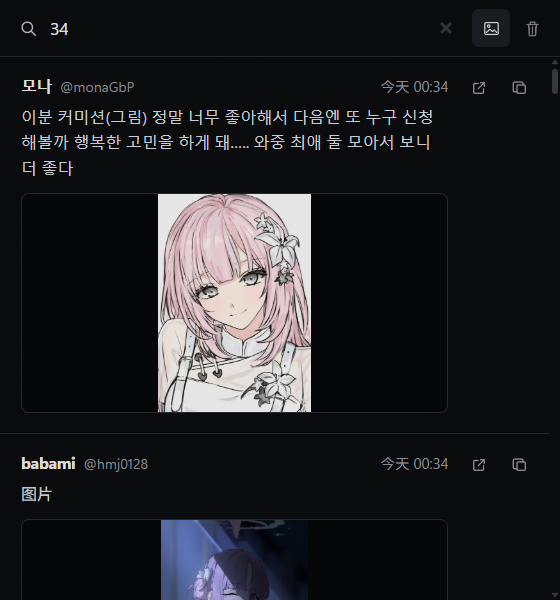

# XRecall

自动保存你在 X 上看过或交互过的推文，附带一张截图预览，可在本机随时搜索找回。无需账号，数据不出本机。

  
  

## 安装

1. 从 [Releases](https://github.com/ichaivalx/x-tweet-recall/releases) 下载最新的 zip 并解压，或直接克隆本仓库。
2. 打开 `chrome://extensions/`，开启右上角“开发者模式”。
3. 点“加载已解压的扩展程序”，选择解压或克隆得到的文件夹。
4. 刷新已打开的 X 页面。

建议在拼图菜单里把 XRecall 固定到工具栏。

## 使用

- **搜索**：支持作者、正文和记录时间。时间可以随意写，`14`、`12:15`、`1215`、`12点15分` 都能匹配。
- **数字键盘**：点搜索框展开，用鼠标输入数字；滚动列表时自动收起。
- **预览**：工具栏按钮可显示或隐藏全部截图。
- **删除**：按 7 天、1 个月、2 个月、半年前或全部清理，确认后连同预览一起删除，无法恢复。

## 记录规则

- 打开具体推文页面时立即记录。
- 在 Feed 中点击、右键、复制或操作媒体时记录。
- 推文在屏幕上连续停留 2.5 秒也会记录；快速滚过不会。
- 同一条推文只保留一份，重复遇到时更新最近时间和次数。

## 数据

- 记录存在 Chrome 扩展本地存储，截图存在扩展自己的数据库，不上传、不跨设备同步。
- 不限条数，不会自动删除；卸载扩展会清空全部数据。
- 截图需要扩展有读取网页的权限，但只处理 x.com 和 twitter.com 的页面。

## 文件

- `scripts/recorder.js`、`scripts/feed.js`：在 X 页面上识别并记录推文。
- `scripts/background.js`、`scripts/preview-db.js`：截图、存储预览和删除数据。
- `popup.html`、`scripts/popup.js`：工具栏弹窗。

X 改版后如果出现只存了链接、作者或正文为空的情况，通常只需更新页面元素的识别规则，已保存的记录不受影响。

## 说明

个人自用，不保证适配所有环境。不接受 PR，想改什么请自行 fork。

以 [MIT](LICENSE) 许可证发布。
